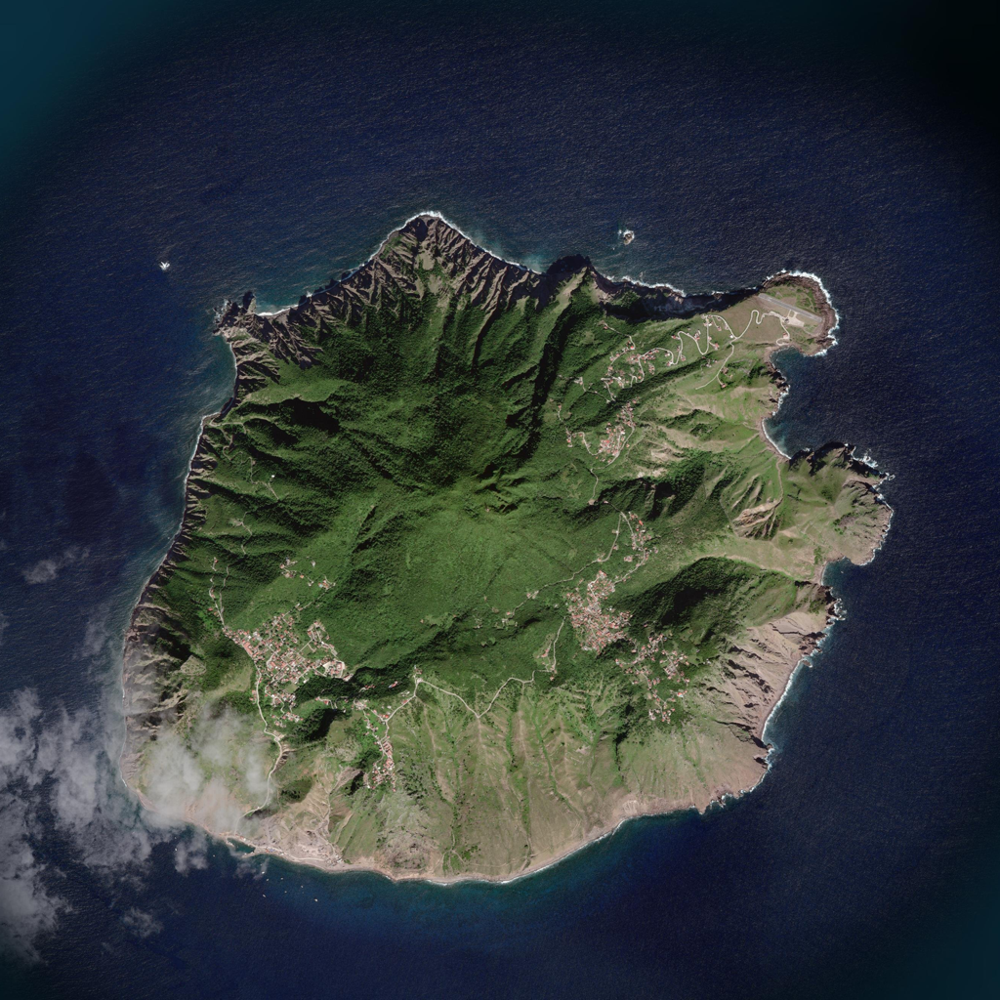
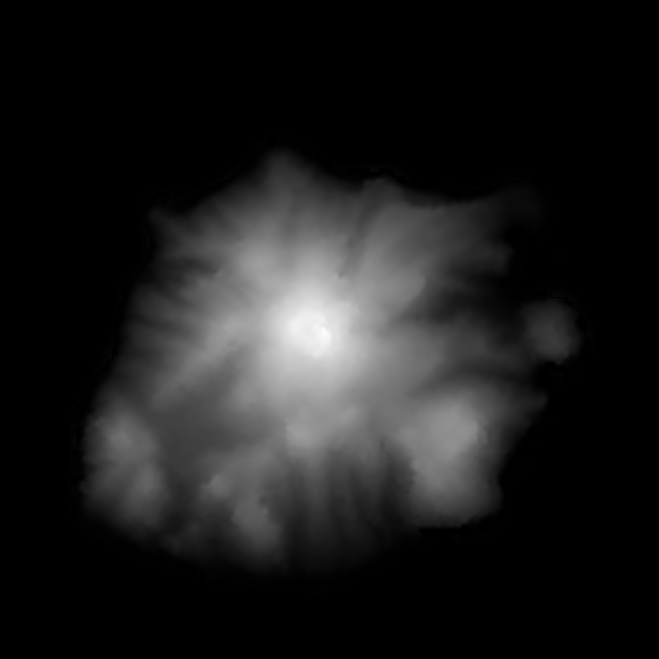
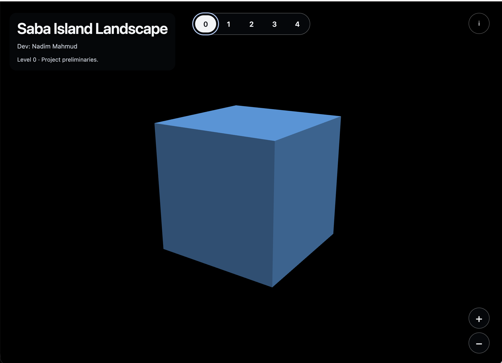
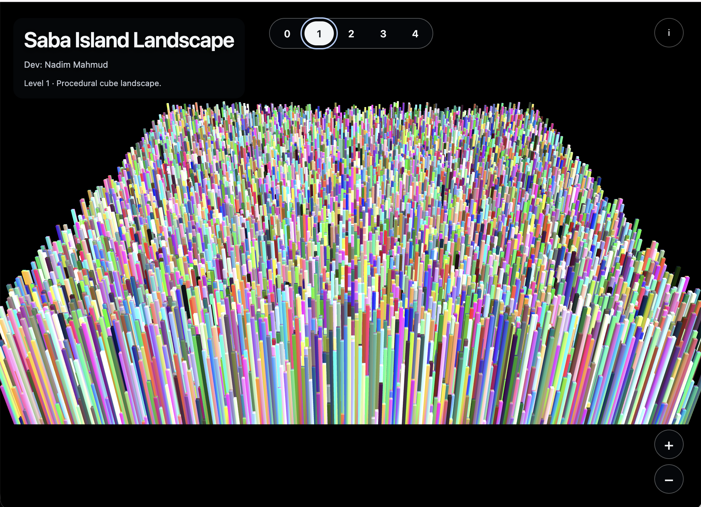
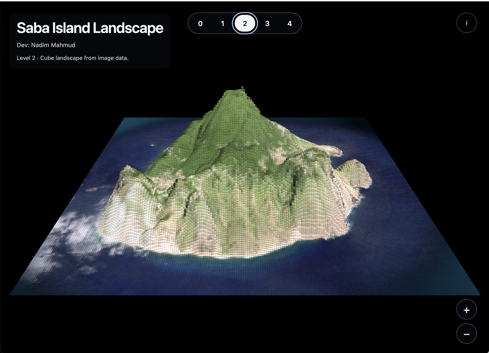
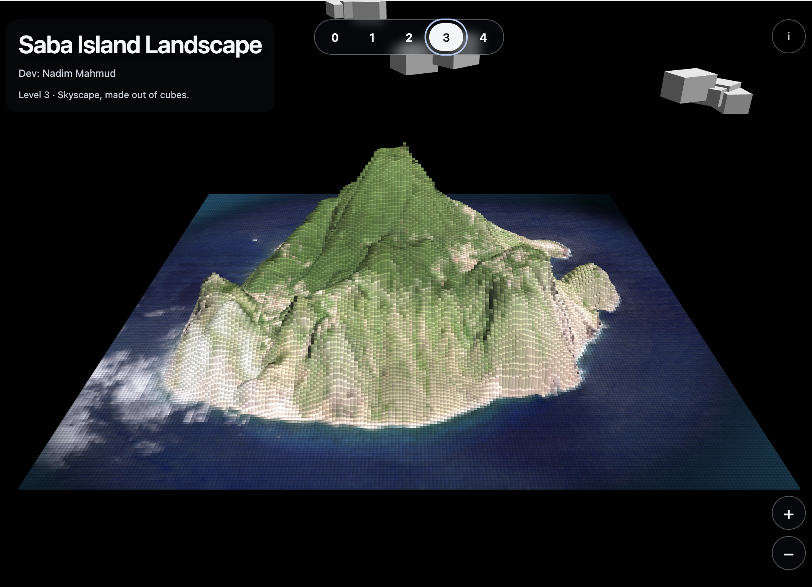
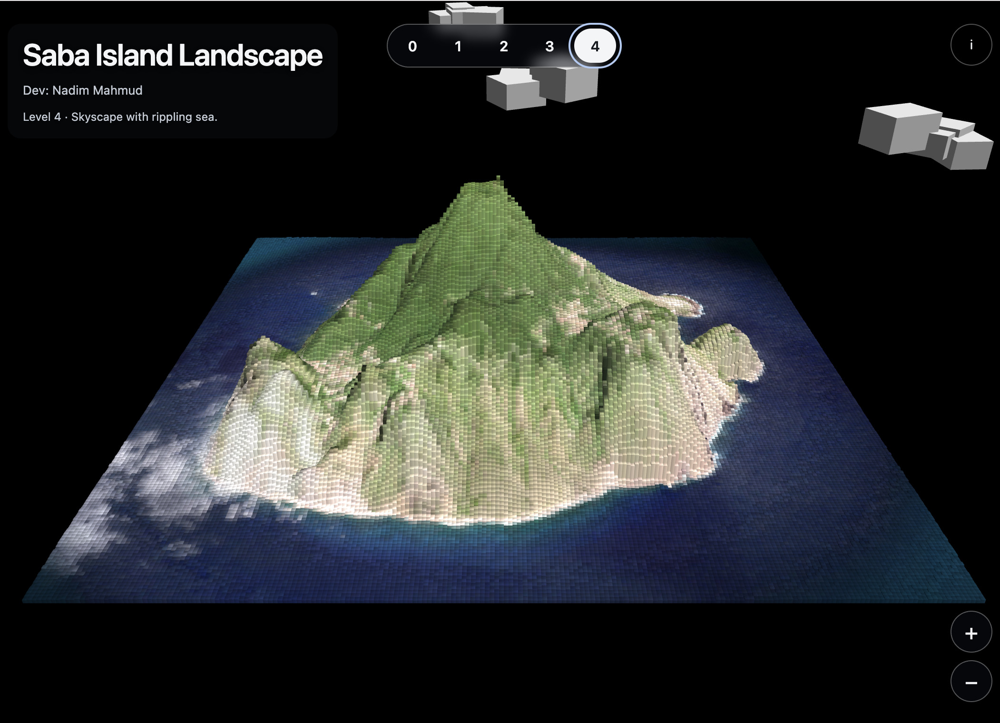
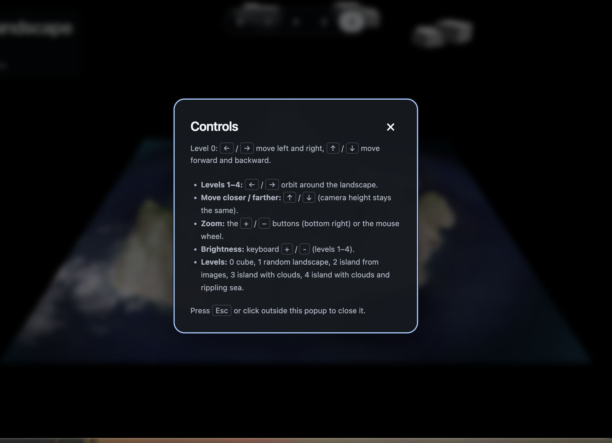

# Image2CubeModel - Mount Saba 3D

A 3D island scene built from a satellite image and height map. Rendered from scratch: vertices, edges, triangles, pinhole camera. WebGL used for parallel rasterization.

- **Live demo:** [Mount Saba Webview](https://nadim-mahmud.github.io/ComputerGraphics/Image2CubeModel/)
- **Demo video:** [View Link](https://youtu.be/EuOInRfqIqw)

---
## Overview

Image2CubeModel turns a 2D satellite image and a height map into an interactive 3D scene made of cubes. The target is **Mount Saba**, a volcanic island in the Caribbean.

The image is sampled down to a grid. Each grid cell becomes one cube column: the satellite pixel sets its color, the height map sets its height. Result is a blocky, voxel-style island.

The scene is built up in five levels, from a single cube (L0) to the island with moving clouds and a rippling sea (L4). Each level adds one computer graphics idea:

- 3D objects as vertices, edges and triangles
- Pinhole camera and perspective projection
- Model → world → camera → screen transforms
- Per-vertex color interpolation
- Image sampling
- Bezier curve animation (clouds)
- Sine-wave animation (sea)

The math (matrices, camera, projection) is written from scratch in [math.js](math.js). Scene building and rendering are in [index.js](index.js). WebGL is used only to rasterize triangles in parallel on the GPU.

---

## Design Plans

I thought I will draw a model of Mount Fuji and then use a 2D Gaussian function plus random noise to generate mountain shape.

Later I realized I need to replicate a real picture. Downloaded Mount Fuji satellite view but that was too symmetric, boring. After searching, found **Mount Saba Island, Caribbean**. Which have more cinematic shape.

Used GPT help to figure out how to get the island snapshot and the height map. I created a pythonscrip to download its satelite image and elevations.

<figure>

	<figcaption>Figure 1: Satellite image and height map of Mount Saba used for the island's terrain colors and elevation.</figcaption>
</figure>

---

## Features and Controls

Four levels, switched with on-screen level buttons.

| Level | Description                                                                                                                                |
| ----- | ------------------------------------------------------------------------------------------------------------------------------------------ |
| L0    | Simple cube                                                                                                                                |
| L1    | Random landscape: random cube height, random colors, different vertex colors interpolated through the vertex shader                        |
| L2    | Island from images: load image, sample to match defined grid size, derive colors and heights, build the scene                              |
| L3    | Island + clouds: randomly positioned cubes following a Bezier curve path                                                                   |
| L4    | Island + clouds + rippling sea: cube brightness changed along a sine wave path, wave moves inward. Not physically real, approximates waves |

### Controls

| Input                                           | Action                           |
| ----------------------------------------------- | -------------------------------- |
| Level 0: ← / →                                  | Move left / right / Orbit around |
| Level 0: ↑ / ↓                                  | Move forward / backward          |
| `+` / `−` buttons (bottom right) or mouse wheel | Zoom in / out                    |
| Keyboard `+` / `-` (levels 1 - 4)               | Brightness up / down             |

---

## Implementation and Course Concepts

**Transform pipeline**

Each point goes **model → world → camera → screen**, with webGl vertexShader.

- Model space: each cube / terrain column defined by its own vertices.
- World space: placed on grid by position derived from image.
- Camera space: view transform from orbiting camera.
- Screen space: pinhole perspective projection divides by depth, maps to pixels.

**Pinhole Camera:** Perspective projection, x' = f·x/z, y' = f·y/z. Farther objects shrink. Zoom changes focal length / distance.

**3D objects as vertices and edges:** Cubes are stored as vertex lists with edge / triangle index lists. Heights from the height map set vertex Y; colors from the satellite image set vertex color.

**Triangle drawing:** Faces rasterized as triangles. Per-vertex color interpolated across triangle (L1 onward). Vertex shader passes color to fragment stage.

**Image sampling:** Image sampled down to defined grid size. Each cell gives color + height → one column / cube.

**Bezier curves:** Clouds (L3) move along a Bezier curve path. Random cube positions form cloud bodies.

**Waves L4** sea: brightness of selected cubes modulated by sine function of position and time. Phase shift moves wave inward.

**WebGL** Used for GPU parallelism: vertices and pixels processed in parallel via shaders.

---

## Future Work

- Real wave geometry (displace sea vertices, not only brightness).
- Smoother terrain: more grid resolution, mesh smoothing instead of cubes.
- Lighting / shadows.
- Textured terrain instead of per-vertex color.
- Load any user-supplied image + height map.
- Cloud shape variety and shadows on sea.
- I want to put a sun.
